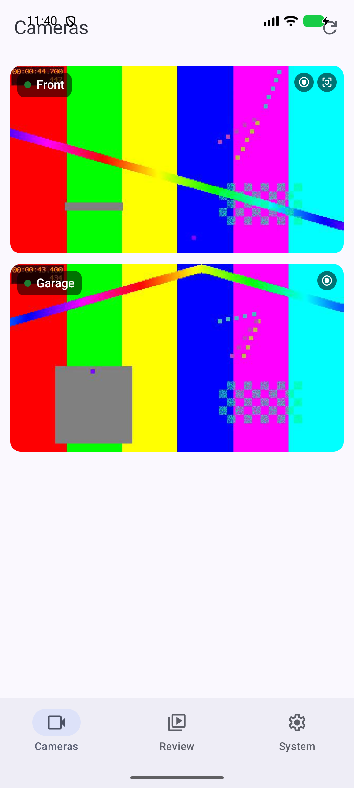
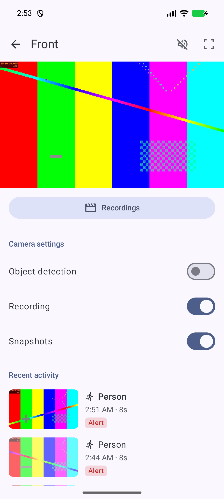
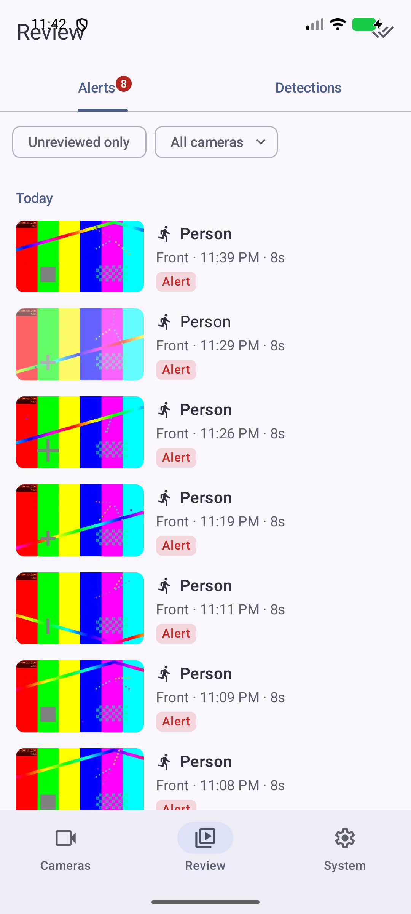
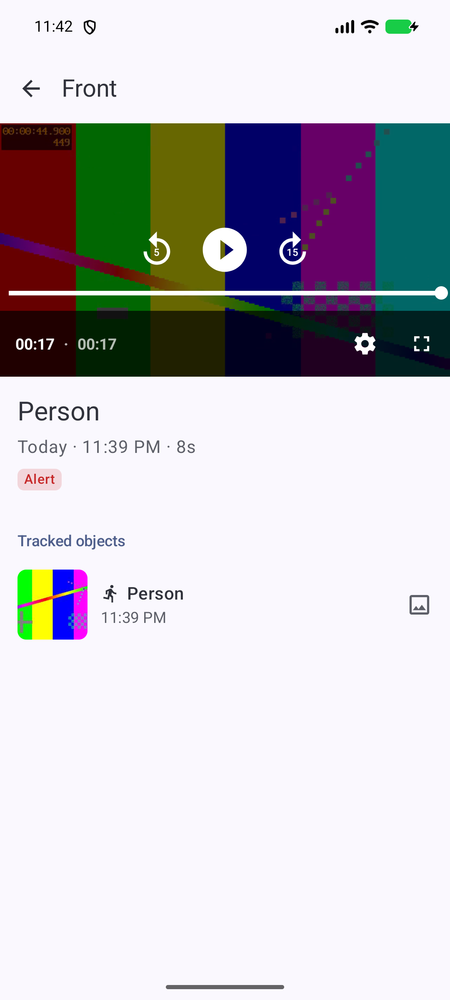
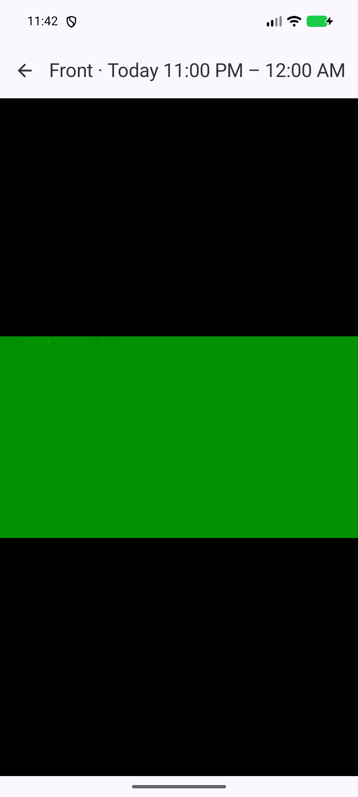
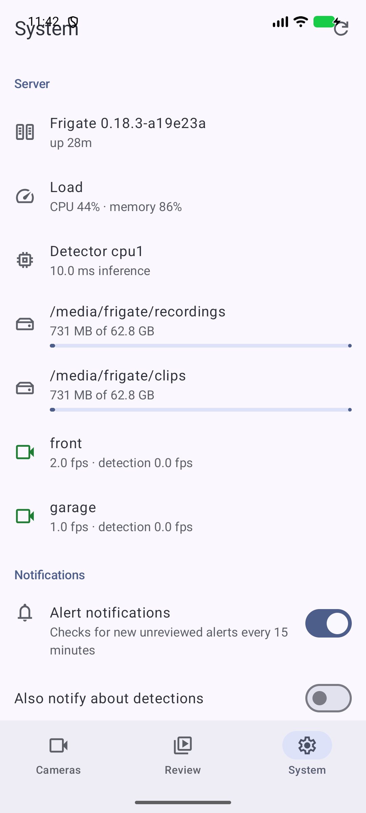
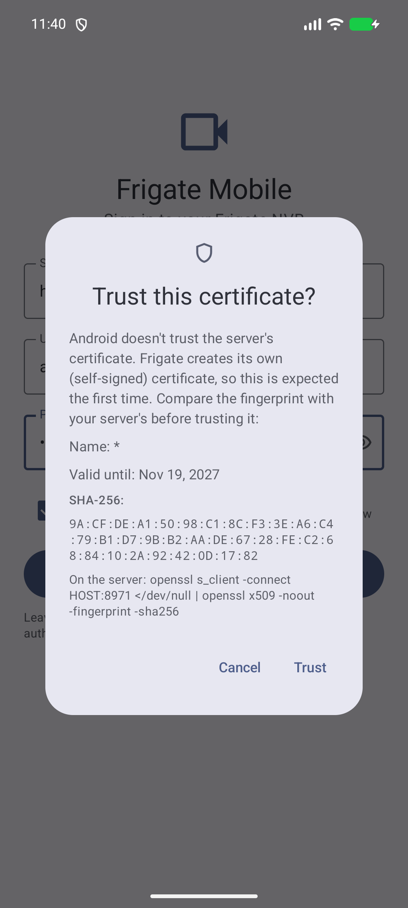

# Frigate Mobile: an Android app for Frigate NVR

An unofficial, **native** Android client for [Frigate](https://frigate.video), the open-source NVR with real-time
object detection. Written in Kotlin with Jetpack Compose and Material 3. It isn't a web wrapper: the app talks to your
Frigate server's API directly, with no cloud service in between and no tracking.

<p>
  
  
  
  
</p>
<p>
  
  
  
</p>

## Features

- **Cameras:** all cameras live (each camera's go2rtc sub stream, muted, only the cards on screen), or a still frame
  every 2 s for cameras without go2rtc / with "Live camera grid" off; online status, recording and detection badges.
- **Live view:** the camera's own stream through Frigate's go2rtc (full resolution and frame rate, optional sound:
  cameras' G.711 audio arrives as FLAC that Android can't decode, so the app decodes it itself),
  with a choice between the camera's streams (e.g. main/sub). Cameras without a go2rtc stream fall back to Frigate's
  MJPEG feed (three quality levels, optional detection boxes). Full screen in landscape; streams only while open.
- **Two-way audio:** tap the microphone on a camera with a speaker to talk through it, tap again to stop (like
  Frigate's web UI: WebRTC to go2rtc's backchannel). Shown when Frigate's go2rtc reports the camera can receive audio,
  e.g. a Tapo (`tapo://` source with the TP-Link cloud password), an XMeye/DVRIP camera (`dvrip://…?backchannel=1`) or
  an ONVIF camera with an audio backchannel. Needs go2rtc's WebRTC port (8555) reachable from the phone and listed in
  `go2rtc: webrtc: candidates` (e.g. `- 192.168.1.10:8555`); on the LAN or over a VPN.
- **PTZ (ONVIF):** hold the arrows to pan/tilt, zoom in/out, go to presets; also as an overlay in full screen.
  Shown for cameras with `onvif` configured in Frigate.
- **Review:** alerts and detections (Frigate 0.14+ review items), newest first, grouped by day, filtered to
  unreviewed items and by camera, with unreviewed counts. "Mark all as reviewed".
- **Review item:** plays the recording around the activity (seekable HLS), lists tracked objects with score, zones
  and snapshots, and marks the item reviewed, like the web UI.
- **Recordings:** a camera's recordings by day and hour; tap an hour to play it.
- **Camera switches (admins):** object detection, recording, snapshots and audio detection (needs Frigate 0.17+,
  which added the REST endpoint for them).
- **System:** Frigate version and update notice, uptime, detector inference speed, CPU/GPU load, storage use and
  per-camera FPS.
- **Notifications (optional):** new unreviewed alerts (optionally detections) with thumbnail, checked every 15
  minutes. Thumbnails are hidden on the lock screen.
- **App icon:** the built-in camera or frigate-bird icon (changes the launcher icon), or your own image, shown
  in the app and addable to the home screen as a shortcut (Android doesn't let apps use an arbitrary image as their
  launcher icon).
- Light/dark theme, Material You colors.

## Install

Download the APK from [Releases](https://github.com/revocx35/frigate-mobile/releases) and install it (Android 8.0+).
Enter your Frigate address, e.g. `https://192.168.1.10:8971` (Frigate's authenticated TLS port) or the HTTPS address
of your reverse proxy, and sign in with a Frigate user. Leave username and password empty if your Frigate has
authentication turned off.

On first sign-in to a server with Frigate's own self-signed certificate, the app shows the certificate's SHA-256
fingerprint. Compare it with the server's before trusting it:

```sh
openssl s_client -connect <host>:8971 </dev/null 2>/dev/null | openssl x509 -noout -fingerprint -sha256
```

Tested against **Frigate 0.18.3** (live, end to end). The API it uses exists since 0.14; camera switches need 0.17+.

## Security

- **HTTPS only.** Passwords, session tokens and camera video never travel in cleartext; plain `http://` addresses
  (Frigate's unauthenticated port 5000) are refused.
- Self-signed certificates are trusted only after you confirm the fingerprint, and only that exact certificate, only
  for that host.
- The session cookie is only sent to your Frigate server, never to another host.
- The session token and, only if you enable "stay signed in", your password are encrypted with a key from the
  Android Keystore that never leaves the device. App backups are disabled. Signing out forgets both.
- On Android 17+ the app asks for the local network ("Nearby devices") permission when your server is on your LAN.

See [ARCHITECTURE.md](ARCHITECTURE.md) for the threat model.

## Building

JDK 21 and the Android SDK (compileSdk 37):

```sh
echo "sdk.dir=/path/to/android-sdk" > local.properties
./gradlew :core:test :app:testDebugUnitTest :app:lintDebug :app:assembleDebug
```

Live tests against a disposable Frigate in Docker: `eval "$(scripts/dev-frigate.sh up)"`, rerun the tests, then
`scripts/dev-frigate.sh down`. Details for contributors (and AI agents) are in [AGENTS.md](AGENTS.md).

## License

MIT. Frigate is a trademark of its owners; this project is not affiliated with or endorsed by the Frigate project.
